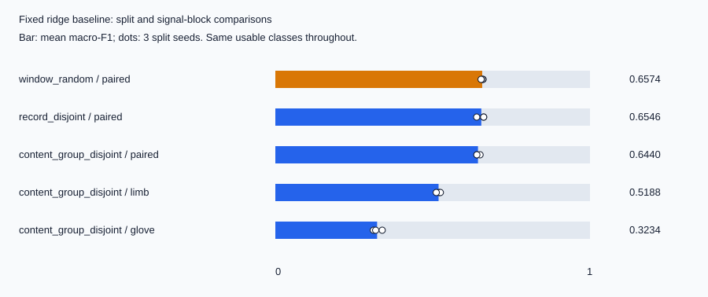

# REHAB wearable signal audit

[](https://github.com/Aleck-Tao/rehab-wearable-signal-audit/actions/workflows/ci.yml)

**What changes when rehabilitation exercise recognition is evaluated on unseen recordings rather than randomly held-out windows?**

An independent analysis of the public [REHAB exercise dataset](https://doi.org/10.57760/sciencedb.37018): file integrity, overlapping windows, repeated signal contents, and the contribution of limb and glove measurements. A fixed NumPy ridge classifier keeps the model small enough to inspect the evaluation itself.

## Findings

The run covers **4,257 paired records, 76,626 windows and 15 movement classes**, using three fixed split seeds. All 32 downloaded files match the publisher's checksums. One has an invalid NumPy header; its movement class is excluded consistently from every comparison ([input exception](docs/input_exception.md)).

| Held-out unit | Signals | Mean window macro-F1 |
|---|---|---:|
| Random windows | Limb + glove | 0.6574 |
| Record rows | Limb + glove | 0.6546 |
| Paired-signal content groups | Limb + glove | 0.6440 |
| Same content-group split | Limb only | 0.5188 |
| Same content-group split | Glove only | 0.3234 |



- **Window overlap:** 99.98% of random-split test windows share source time positions with training windows. Record holdout removes this overlap, but the score change is small and not consistent across seeds.
- **Repeated contents:** there are 636 repeated full-record contents beyond their first occurrence. Even with distinct row IDs, 22.83% of test windows on average belong to complete paired signals also present in training. Grouping identical paired signals removes that sharing.
- **Signal-block comparison:** paired signals score higher than either block alone under the same content-group assignments. This is a fixed-feature baseline result, not a clinical benefit or a sensor-failure test. The grouping key contains both blocks; individual blocks can still repeat across the split and are audited separately.

[Full results and seed ranges](results/study.md) · [Per-class scores](results/per_class.csv) · [Confusion matrices](results/summary.json)

The split protocols hold out different examples and class supports, so their score differences are not a causal estimate of leakage. Three seeds describe split sensitivity, not uncertainty across patients.

## Run it

Python 3.11 or newer; the numerical dependency is pinned to NumPy 2.3.5. From a clone of this repository:

```bash
python -m pip install -e .
python -m unittest discover -s tests -v
python -m rehab_audit verify

# About 383 MiB, from Science Data Bank; raw arrays stay in ignored data/cache/.
python -m rehab_audit fetch
python -m rehab_audit check
```

`verify` checks the committed source/configuration and aggregate result hashes without downloading data. `check` also revalidates the cached source arrays, reruns all 15 fits, and compares every published result file. If local record-level outputs exist, it compares those too. To regenerate the saved evidence after an intentional analysis change, use `python -m rehab_audit run`.

CI runs unit tests and hash verification on Windows and Linux, including a weekly check. The manual **reproducibility → Run workflow → full_data** option downloads the source arrays, replays the study, and retains regenerated aggregate evidence as an artifact. Record-level outputs are excluded from the upload. Scheduled checks do not silently change results or publish new research claims.

## What is held fixed

Windows contain 200 samples at stride 40. Each channel contributes mean, standard deviation, range, RMS and mean absolute first difference. Scaling is fitted on training data only; ridge alpha is 1.0, with no test-set tuning. Limb and glove ablations use the same paired-content split and class set. [Configuration](config/study.json) and [protocol differences from upstream](docs/upstream_protocol.md) define the comparison.

Published evidence includes the [publisher file inventory](config/source_files.json), [input validation](results/inventory.json), [aggregate and per-class results](results/summary.json), and [source/result hashes](results/manifest.json). A local run also writes the row-level content/tail audit, split assignments and held-out predictions to ignored `results/record-level/`. These fine-grained derivatives are not redistributed on GitHub; they can be regenerated from the attributed public source. Nothing is silently repaired, deduplicated, or removed because its score is inconvenient.

## Interpretation and next question

These arrays contain limb orientation and glove angle channels, not raw accelerometer/gyroscope streams. Sensor files are paired by movement and row index; matching dimensions alone cannot verify acquisition synchronization. No patient-to-row mapping is available in the downloaded exercise arrays, so **record or content holdout is not patient holdout**. Exact hashes do not detect near duplicates or shared sessions.

1,108 records have a constant all-channel suffix of at least 200 samples. This is a candidate-padding indicator, not a recovered recording boundary; those suffixes remain untouched. The next useful extension is to test how tail handling changes the fixed baseline, then repeat with patient/session grouping if the necessary metadata becomes available. Angle-wrap-aware features are another concrete comparison; the current features do not unwrap angles.

## Sources and reuse

Dataset: Liquan Guo, Science Data Bank, V1, [10.57760/sciencedb.37018](https://doi.org/10.57760/sciencedb.37018). Related paper: Lv et al., *Scientific Data* 13, 1136 (2026), [10.1038/s41597-026-07802-2](https://doi.org/10.1038/s41597-026-07802-2). The [paper-linked code](https://github.com/zzzzz-123/REHAB/tree/1073d6cb147e502cbfccd86c3011e7c487cbdb70) supplies the protocol reference; its source and weights are not copied here.

Independent code: MIT. Derived data outputs: CC BY 4.0 with dataset attribution; see [DATA_NOTICE.md](DATA_NOTICE.md). This project is not affiliated with the dataset authors and does not reproduce their clinical study or neural-model benchmark.
